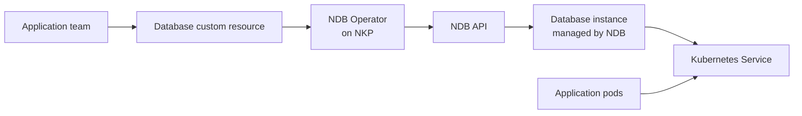

# Nutanix Database Service

Nutanix Database Service (NDB) provides database-as-a-service lifecycle
management. The NDB Operator exposes part of that service through Kubernetes
custom resources, allowing application teams to request databases through the
Kubernetes API.

The operator is optional and is not installed as part of a standard NKP cluster.
Install it on the workload cluster where application teams will create database
resources.

## Architecture



The operator reconciles two main resource types:

- `NDBServer` is cluster-scoped and describes an NDB API endpoint. It references
  credentials stored in a restricted Kubernetes namespace.
- `Database` is namespaced and declares a database to provision or clone through
  the referenced `NDBServer`.

The database does not normally run as a pod on the NKP worker nodes. NDB
provisions and manages the database infrastructure, while the operator creates
Kubernetes connectivity for applications.

!!! note "Installing the operator does not install NDB"
    An operational and licensed NDB environment must already exist. The
    Kubernetes cluster needs network and DNS connectivity to its API.

## Before you begin

Confirm:

- the NDB release is compatible with the selected operator version;
- the target is a workload cluster rather than the NKP management cluster;
- `kubectl` and Helm target the intended cluster;
- the cluster can reach the NDB API, normally over HTTPS;
- the cluster can pull the chart and operator images, or they are mirrored
  internally;
- cert-manager is installed, as required by the operator on Kubernetes
  distributions other than OpenShift;
- a trusted CA certificate is available for the NDB API;
- platform and database teams have agreed who can create `NDBServer` and
  `Database` resources.

Check the current context before installing:

```bash
kubectl config current-context
kubectl cluster-info
helm version
kubectl get pods -n cert-manager
```

## Install the operator

The chart is published as an OCI artifact in the Nutanix Cloud Native GitHub
Container Registry:

```bash
helm install ndb-operator \
  oci://ghcr.io/nutanix-cloud-native/chart/ndb-operator \
  --namespace ndb-operator-system \
  --create-namespace
```

Without `--version`, Helm installs the latest chart available at that time.
Inspect and pin an approved version for repeatable production deployment:

```bash
helm show chart \
  oci://ghcr.io/nutanix-cloud-native/chart/ndb-operator

helm upgrade --install ndb-operator \
  oci://ghcr.io/nutanix-cloud-native/chart/ndb-operator \
  --namespace ndb-operator-system \
  --create-namespace \
  --version <approved-chart-version> \
  --wait \
  --timeout 5m
```

This guide was checked with chart `0.5.10`, which reports operator application
version `v0.5.7`. Use the version approved for the NDB and NKP releases in the
target environment.

## Verify the installation

```bash
helm status ndb-operator -n ndb-operator-system
kubectl get pods -n ndb-operator-system
kubectl get crd \
  ndbservers.ndb.nutanix.com \
  databases.ndb.nutanix.com
kubectl api-resources --api-group=ndb.nutanix.com
```

Wait for the operator deployment to become available:

```bash
kubectl rollout status deployment/ndb-operator-controller-manager \
  -n ndb-operator-system \
  --timeout=5m
```

If the deployment name differs, discover it with:

```bash
kubectl get deployments -n ndb-operator-system
```

## Connect the operator to NDB

Create a restricted namespace and Secret containing the NDB API credentials. The
current operator expects `username`, `password`, and optionally
`ca_certificate` keys:

```bash
kubectl create namespace ndb-credentials
```

Create the Secret through the organization's approved secret-management process.
Do not commit credentials or pass clear-text passwords on a command line.

Create a cluster-scoped `NDBServer` resource that references the Secret:

```yaml
apiVersion: ndb.nutanix.com/v1alpha1
kind: NDBServer
metadata:
  name: ndb
spec:
  server: https://ndb.example.com:8443/era/v0.9
  credentialSecretRef:
    name: ndb-api-credentials
    namespace: ndb-credentials
  skipCertificateVerification: false
```

Apply and inspect it:

```bash
kubectl apply -f ndbserver.yaml
kubectl get ndbserver ndb
kubectl describe ndbserver ndb
```

Use the CA certificate in the credential Secret instead of disabling TLS
verification. The exact API endpoint and certificate chain depend on the NDB
deployment.

## Provision databases

Application teams create namespaced `Database` resources that refer to the
cluster-scoped NDB connection through `spec.ndbRef`.

Database manifests also include the engine, profile, network, SLA, credentials,
and sizing required by that request. These fields depend on the NDB environment
and operator release. Start from the
[NDB Operator examples](https://github.com/nutanix-cloud-native/ndb-operator)
rather than copying an example for a different version.

The current upstream operator documents PostgreSQL, MySQL, MongoDB, Microsoft
SQL Server, and Oracle Single Instance support. Availability and supported
topologies still depend on the NDB release and licenses.

## Security and multi-tenancy

`NDBServer` is cluster-scoped, while `Database` is namespaced. Treat the NDB
connection as a platform-level resource:

- keep NDB API credentials in a namespace that application teams cannot read;
- grant access to `Database` resources with namespace RBAC;
- restrict which `NDBServer` resources, database engines, profiles, networks,
  and SLAs teams may use;
- use separate NDB credentials or endpoints where organizational boundaries
  require them;
- audit database creation, cloning, and deletion in Kubernetes and NDB.

An NKP project does not automatically restrict use of a cluster-scoped
`NDBServer`. Include this resource in the
[multi-tenancy](multi-tenancy.md) and admission-policy design.

## Lifecycle considerations

A `Database` resource represents infrastructure outside Kubernetes. Deleting it
can trigger database and VM deprovisioning through NDB.

!!! danger "Review deletion behavior before enabling self-service"
    Test create, clone, restore, and deletion workflows with non-production data.
    Do not remove operator finalizers manually; doing so can orphan database
    infrastructure in NDB.

Do not uninstall the operator while it still manages `Database` resources. The
controller must remain available to complete reconciliation and cleanup.

Operators older than `0.5.3` used a namespaced `NDBServer`. Current releases use
a cluster-scoped resource and `credentialSecretRef`. Follow the upstream
migration procedure when upgrading an older installation; this CRD scope change
is not an in-place update.

## Restricted and air-gapped environments

The OCI chart and every image referenced by its rendered manifests must be
available from an internal registry. Render the approved chart version, identify
all image references, mirror them, and supply the required chart values before
installation.

Do not assume that mirroring only the controller image is sufficient. Operator,
webhook, proxy, and cert-manager images can all be part of the working
installation.

## Further reading

- [NDB Operator source and examples](https://github.com/nutanix-cloud-native/ndb-operator)
- [Nutanix Database Service](https://www.nutanix.com/products/database-service)
- [Platform applications](platform-applications.md)
