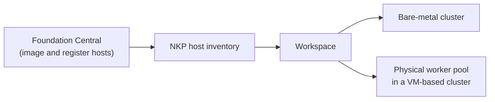

# NKP Metal (bare metal)

> Introduced in NKP 2.19. This page is a concept overview based on the release
> information. It does not contain a tested procedure.

NKP Metal lets NKP run Kubernetes directly on physical servers instead of on AHV
virtual machines. It uses the same management model as the rest of NKP, so
bare-metal clusters sit in workspaces next to VM-based clusters.

## Why bare metal

Running on physical hosts gives workloads direct access to compute, networking,
storage, and accelerators. This suits GPU-heavy AI workloads, latency-sensitive
applications, and edge sites where a hypervisor layer is unnecessary overhead.

## How it works

1. **Image and register hosts.** Foundation Central images the physical servers
   and registers them with NKP.
2. **Host inventory.** Registered hosts appear in the NKP host inventory. In the
   2.19 UI this is the **Metal Host Inventory** page under Administration.
3. **Assign hosts to a workspace.** Hosts are assigned like other infrastructure
   resources.
4. **Create a cluster.** You can build a full bare-metal cluster, or add physical
   worker node pools to a VM-based cluster.

## What this means for your design

- **Mixed clusters are possible.** A VM-based cluster can have physical worker
  pools, for example for GPU nodes.
- **Lifecycle differs from VMs.** There is no hypervisor to snapshot or live
  migrate. Plan host failure, maintenance, and re-imaging accordingly.
- **It is a first release.** An existing cluster does not change type on its
  own. Review requirements and dependencies before you plan a migration.

!!! tip "Where to get the procedure"
    The installation and host-onboarding steps are in the NKP 2.19 documentation
    on the Nutanix support portal. You can also ask the Nutanix Intelligent
    Virtual Agent (NIVA).

## Related guides

- [Clusters](clusters.md)
- [Cluster lifecycle](cluster-lifecycle.md)
- [Workspaces and projects](workspaces-and-projects.md)
