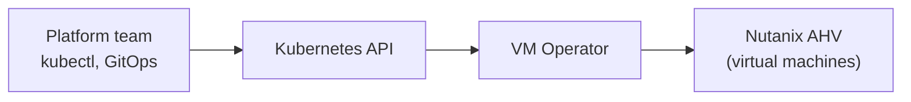

# VM Operator

> Introduced in NKP 2.19. This page is a concept overview based on the release
> information. It does not contain a tested procedure.

The VM Operator manages Nutanix AHV virtual machines through Kubernetes APIs.
Platform teams can provision, update, monitor, and remove Linux and Windows VMs
with the same declarative workflows they use for containers.

## The idea

Kubernetes already reconciles desired state for pods and deployments. An
operator extends that model to a new kind of resource. The VM Operator does this
for AHV virtual machines: you describe a VM as a Kubernetes resource, and the
operator drives Prism to match it.

This is similar to how [Cluster API](cluster-lifecycle.md) turns clusters into
Kubernetes resources. Cluster API manages the machines that run Kubernetes. The
VM Operator manages virtual machines for workloads that are not containerized.

## How you get it

The VM Operator is delivered through the NKP application catalog. It is not part
of the base platform. Enable it on the cluster that should manage the VMs, in the
same way as other
[catalog applications](platform-applications.md#platform-applications-and-catalog-applications).

## When to use it

- Applications that cannot yet be containerized but run next to containerized
  services.
- Teams that want one GitOps workflow for both VMs and containers.
- Environments that combine this with [NKP Metal](nkp-metal.md) for a single
  control plane across bare metal, VMs, and containers.

Only the VM lifecycle operations that Nutanix lists as supported are available.
Check the NKP 2.19 documentation before you plan to move a workload.

!!! tip "Where to get the procedure"
    Installation and usage steps are in the NKP 2.19 documentation on the Nutanix
    support portal. You can also ask the Nutanix Intelligent Virtual Agent (NIVA).

## Related guides

- [Platform applications](platform-applications.md)
- [Cluster lifecycle](cluster-lifecycle.md)
