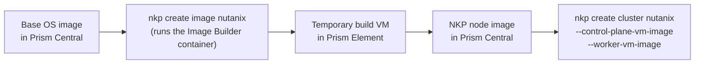

# Node images

Every NKP cluster node boots from an operating system image that already
contains the NKP-required components: the container runtime, kubelet, Kubernetes
packages, and supporting dependencies. On Nutanix AHV, that image is stored in
Prism Central and referenced when you create or scale a cluster.

You have two ways to get one:

| | Pre-built image | Custom image |
| --- | --- | --- |
| **Source** | Downloaded from the Nutanix Support Portal | Built by you with `nkp create image nutanix` |
| **Licence** | Starter, Pro, Ultimate | Pro or Ultimate only |
| **Time to first cluster** | Minutes (download and upload) | Longer (a build runs in Prism) |
| **Patching** | Nutanix publishes updated images | You rebuild and roll out new images |
| **CIS Level 1 OS hardening** | Supported | Not supported[^cis] |
| **Extra packages, your own base configuration** | No | Yes |
| **GPU and vGPU** | Ubuntu image supports GPU; Rocky image does not | Yes, depending on the operating system. Supported NVIDIA drivers can be installed with `--gpu-name` and `--vgpu-runfile` |
| **FIPS** | Not supported | Yes, with `--fips`, on operating systems that support it |

[^cis]: In NKP 2.19, CIS Level 1 hardening is available only in the
    pre-built Rocky Linux and Ubuntu images. It is not a supported override for
    custom images. If you need CIS, use the pre-built image.

!!! tip "Start with the pre-built image"
    Build a custom image only when you need something the pre-built image cannot
    give you, such as an organisation-specific base configuration, FIPS, or
    pre-installed drivers. A custom image is something you must rebuild and test
    for every Kubernetes patch release.

## How the build works

1. You run `nkp create image nutanix` from a bootstrap host with Docker or
   Podman. The command starts the Nutanix Image Builder (NIB) in a container.
2. NIB creates a temporary VM in the Prism Element cluster and subnet you
   specify, starting from the base image.
3. NIB installs and configures the NKP and Kubernetes components, then saves the
   result as a new image in Prism Central. The temporary VM exists only for the
   build.
4. The command prints the new image name, for example
   `nkp-ubuntu-24.04-1.36.2-20260101120000`. Pass that name to
   `--control-plane-vm-image` and `--worker-vm-image` when you create a cluster.

In an air-gapped environment the build VM cannot reach OS package
repositories. You first create a **package bundle** on an internet-connected
host and carry it into the restricted network. See
[Build a custom image: air-gapped](custom-airgapped.md).

## Supported operating systems

Support differs by NKP release and by feature (FIPS, air-gapped, GPU, vGPU).
Always confirm the exact matrix in the Nutanix documentation for your release on the Nutanix support portal.

Operating systems supported on Nutanix AHV:

| Operating system | Air-gapped | FIPS | FIPS air-gapped | GPU | GPU air-gapped | vGPU | Nutanix Image Builder |
| --- | --- | --- | --- | --- | --- | --- | --- |
| Rocky Linux 9.8 | Yes | - | - | - | - | - | Yes |
| Ubuntu 22.04 | Yes | - | - | Yes | Yes | - | Yes |
| Ubuntu 24.04 | Yes | - | - | Yes | Yes | - | Yes |
| RHEL 8.10 | Yes | Yes | Yes | Yes | Yes | Yes | Yes |
| RHEL 9.6 | Yes | Yes | Yes | Yes | Yes | Yes | Yes |
| RHEL 9.8 | Yes | Yes | Yes | Yes | Yes | Yes | Yes |

All of them support the default configuration. A dash means not applicable.
Kernel versions are on the portal page.

What this means for custom builds:

- **FIPS** images need RHEL.
- **GPU** images need Ubuntu or RHEL. Rocky Linux does not support GPU.
- **vGPU** images need RHEL.
- **Rocky Linux** supports the default and air-gapped builds only.

!!! warning "Verify before you build"
    The lists above were gathered from public release information. They are
    not a substitute for the support matrix, which also covers kernel versions
    and per-feature support. Only x86-64 (AMD64) is supported.

## Where to get help

Keep your builds close to the documented steps. For anything beyond them, such
as custom Ansible roles or unusual base images, use the NKP documentation on the
Nutanix support portal, ask the **Nutanix Intelligent Virtual Agent (NIVA)**, or
open a support case.

## In this chapter

- [Use a pre-built image](prebuilt.md)
- [Build a custom image](custom-connected.md) with internet access
- [Build a custom image: air-gapped](custom-airgapped.md)
- [Customize an image](customization.md): FIPS, GPU, naming, and dry runs
- [Troubleshoot image builds](troubleshooting.md)
