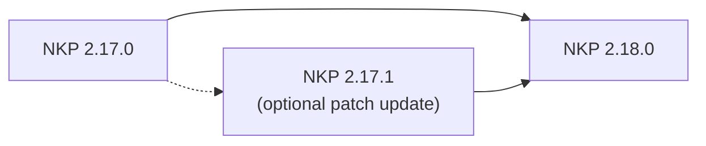

# Upgrade paths

Upgrade guides are separated by target version because supported upgrade
paths, Kubernetes versions, and image requirements vary between NKP releases.

## Supported paths

NKP 2.17.0 can upgrade directly to NKP 2.18.0:

Choose the applicable path:

- [Upgrade from NKP 2.17.x to 2.18.0](2.17.1-to-2.18.0.md)
- [Optional patch upgrade from 2.17.0 to 2.17.1](2.17.0-to-2.17.1.md)

!!! warning "Do not skip minor releases"
    Direct upgrade from NKP 2.16.x to 2.18.0 is not supported. Upgrade to a
    supported NKP 2.17 release first. Patch releases such as 2.17.1 can be
    skipped only when the release specification permits the exact source and
    target path.

## Before any upgrade

- Confirm that the source and target versions form a supported upgrade path.
- Read the release notes and compatibility information.
- Back up important cluster and application data.
- Check management and workload cluster health.
- Make the target node image available in Prism Central.
- Review the complete version-specific procedure before running commands.

## Choose a workflow

Determine whether GitOps or the NKP CLI owns the cluster definition. Do not use an
imperative CLI upgrade for a cluster whose desired state is reconciled from Git.

!!! warning "Treat an upgrade as a rolling infrastructure change"
    Cluster API can replace nodes during a Kubernetes upgrade. Check application
    replicas, disruption budgets, storage attachment behavior, and spare capacity
    before starting.

Select the applicable upgrade guide from the navigation.

!!! tip "Field note: finish each stage across the fleet"
    Upgrade and verify the management cluster, platform applications, and
    managed workload clusters in controlled batches. Running a fleet across
    several upgrade stages makes CLI compatibility and troubleshooting harder.
